<p align="center">
  <a href="https://binetic-agent.local"></a>
</p>

<p align="center">
  <a href="#memory-that-runs"></a>
  <a href="#nothing-phones-home"></a>
  <a href="#local-models"></a>
  <a href="#coming-from-claude-code"></a>
  <a href="./LICENSE.md"></a>
</p>

<p align="center"><strong>An AI harness that thinks in Gno.</strong><br>
Binetic Agent is functional AI: the agent's context is a call stack. It runs the <a href="https://github.com/gnolang/gno">Gno</a> VM in the AI harness and keeps the agent's plan, what it found and the facts you gave it in <code>mem</code>, in Gno on your disk. Each step of a task is a frame: when it returns, its work leaves the model's context and its result stays, as a function's locals go when it returns. A new session starts with what is still open and the newest facts, so it picks up where the last one stopped.</p>

<p align="center">Security-first underneath: a fork of Charm's <a href="https://github.com/charmbracelet/binetic_agent">Binetic Agent</a> that closes the doors a coding agent usually leaves open.</p>

<p align="center">
  <a href="https://binetic-agent.local/binetic-agent-demo.mp4"></a><br>
  <sub>A real run, recorded in Ghostty, with the waiting cut short: Qwen3.8 27B on a home AI box works out the backoff in Gno, plans a task in <code>mem</code>, and a new session finishes it. Click to play.</sub>
</p>

<p align="center">
  <a href="#frames-no-more-compaction">Frames</a> ·
  <a href="#a-swarm-on-one-plan">Swarm</a> ·
  <a href="#memory-that-runs">Memory that runs</a> ·
  <a href="GNOMEM.md">GNOMEM</a> ·
  <a href="#security-first">Security first</a> ·
  <a href="#coming-from-claude-code">Coming from Claude Code</a> ·
  <a href="#what-else-changed-from-binetic_agent">What else changed</a> ·
  <a href="#built-for-gnoland">Built for gno.land</a> ·
  <a href="#installation">Installation</a>
</p>

<picture>
  <source media="(prefers-color-scheme: dark)" srcset="docs/brand/divider-dark.svg">
  
</picture>

<p align="center"><em>“Yo dawg, I heard you like Go, so I put Go in your Go
and slapped it onto Qwen, so it can run Go while it writes Go.”</em></p>

Binetic Agent is a fork of Charm's [Binetic Agent](https://github.com/charmbracelet/binetic_agent):
the same terminal UI, sessions, LSP and MCP support, and any model you like,
from a hosted API to one running on your own machine. On top of that:

- **Frames, not compaction.** The agent's context is a call stack: a todo
  done is cut from the model's context with its result kept, so finished work
  never piles up, and a long task needs no compaction to survive it:
  [frames](#frames-no-more-compaction).
- **A swarm on one plan.** Binetic Agent sessions in one project share one `mem`:
  one plans the work, the others take its free todos, each once, under
  mem's lock. On a server with memory to spare they run side by side for
  little more than the cost of one: six sessions on one 48 GB GPU did a
  nine-package job 1.8x faster than Binetic Agent and 2.7x faster than one Binetic Agent
  session: [the swarm](#a-swarm-on-one-plan).
- **Thinks in Gno.** The Gno VM runs inside Binetic Agent, and the agent works an
  answer out in a machine instead of estimating it:
  [the machines underneath](#thinks-in-gno-the-machines-underneath).
- **Plans in Gno.** A task is a todo in `mem` with the todos under it. A todo
  cannot be closed while one under it is open, so "the tests pass" is
  reached, not claimed; the close of each todo the work is done in is
  checked against what happened in it, and a separate judge checks each
  task the agent closes against the conversation: [a todo that outlives the session](#a-todo-that-outlives-the-session).
- **Remembers in Gno.** What it found, what waits on you and the facts you
  told it stay in `mem` on your disk, and a new session starts with them:
  [memory that runs](#memory-that-runs).
- **Nothing phones home.** No usage metrics, no provider catalog fetch, no
  update check, unless you turn them on.
- **Tool text can't pose as the conversation.** A model's control tokens in a
  web page or command output are defused before the model reads them.
- **The web reader can't read your files.** The sub-agent that reads web pages
  for it can open only the pages it fetched.
- **Mistakes fail closed.** A misspelt guard stops Binetic Agent instead of being
  ignored, and a check that cannot run holds the work up instead of waving it
  through.
- **Speaks Claude Code.** Its flags and its hooks.
- **Fixes what broke.** A long list of things that broke, hung or failed
  without saying so.
- **Knows Gno and gno.land.** Every signature waits for you to type the key's
  password, which the model never sees, and a session key caps what even a
  transaction you approved can spend.

## Frames: no more compaction

A model's context fills with everything it read and ran, until a compaction
throws most of it away and the task limps on from a summary. Binetic Agent works a
task as a call stack instead. Each todo is a frame: the agent enters it
(`mem.Push`), works, and leaves it with a result (`mem.Pop("what came of
it")`), and from then on everything between the push and the pop, the files
it read, the commands it ran, what you said in between, is left out of what
the model is sent. The result stays, in the context and in mem; what a frame
learned beyond its result it keeps first as a thought, which outlives the pop.
Nothing is deleted: you still see all of it, the transcript keeps it, and
nothing the agent did is undone. Only the model's context shrinks, the way a
stack frame goes when a function returns and only its value comes back.

Line by line, where the agent stands (its stack, bottom to top) and what
mem holds; a todo is made under the frame you stand in, and `mem.Next()`
steps into the next open todo under it:

```go
mem.Todo("rename the project").Push()   // stack: rename-project · tree: rename-project
mem.Todo("rename it in the code")       // stack: rename-project · tree: rename-project › rename-code
mem.Todo("rename it in the tests")      // stack: rename-project · tree: rename-project › rename-code, rename-tests
mem.Next()                              // stack: rename-project › rename-code
mem.Pop("go.mod and main.go say binetic-agent") // stack: rename-project · rename-code is done; its work leaves the context
mem.Next()                              // stack: rename-project › rename-tests
```

So a long task runs with the context holding the plan, the results so far and
the present todo's work, however many todos there are. And when the work
outgrows the context before a todo is done, Binetic Agent slides instead of
compacting: the oldest rounds leave the context, those before the first todo
first, since mem holds the plan, the results so far and the thoughts, and the
agent is told so. A summary is made only with nothing to slide. In the model server's log of
a real run, the request after a 3K-token pop re-read 2,572 tokens instead of
the whole 20K-token conversation, and the requests after it were back to a
few hundred each: the cache survived the cut.

In a real run on 31 October 2026, the second session of the rename below,
each pop's result ends with Binetic Agent's own line on what left the context (shown
as it happened; the replayed calls are under
[what the agent runs](#what-the-agent-runs)):

```go
mem.Frame("klash-to-binetic-agent-rename/binetic-agent-readme-rename").Push()
// in `klash-to-binetic-agent-rename/binetic-agent-readme-rename` "rename klash to binetic-agent in README.md": do it now, with your tools; once what they return shows it done, pop it with that and what the next todo needs. …
// … the README read, edited and searched; then
mem.Pop("README.md fully renamed klash→binetic-agent (title, prose, build/usage snippet, config file mentions incl. binetic-agent.toml and binetic-agent.example.toml); case-insensitive grep for klash finds nothing")
// done `klash-to-binetic-agent-rename/binetic-agent-readme-rename` "rename klash to binetic-agent in README.md" → README.md fully renamed klash→binetic-agent (title, prose, build/usage snippet, config file mentions incl. binetic-agent.toml and binetic-agent.example.toml); case-insensitive grep for klash finds nothing
// next: `klash-to-binetic-agent-rename/binetic-agent-build-output-rename` "rename the build output klash to binetic-agent in the Makefile": mem.Frame("klash-to-binetic-agent-rename/binetic-agent-build-output-rename").Push()
// Everything since you entered `klash-to-binetic-agent-rename/binetic-agent-readme-rename` was removed from your context: this result stays; the user still sees all of it. In it you edited README.md. Your reads inside it are forgotten: view a file before you edit it.
```

[GNOMEM](GNOMEM.md#frames) has the design: what a frame holds, what a thought
is, and how a thought becomes a todo of its own.

## A swarm on one plan

A model server with memory to spare runs several requests at once for
little more than the cost of one: on a 48 GB RTX 6000 Ada serving Qwen 3.8
27B with vLLM, one request streamed 30 tokens a second and eight at once
streamed 218 in all, 27 each. A coding session uses one of those streams.
Binetic Agent sessions in one project share one `mem`, so several of them can work
one plan: each takes a free todo with `mem.Next()` under mem's lock, none
takes a todo twice, and one with nothing free waits on mem instead of
polling.

To run one, give binetic-agent the task in one terminal and say others will help:

```
Two more binetic-agent sessions will work on this with you. First plan it in mem,
with the todos that do not depend on each other under .Parallel().
```

Once it has planned, open binetic-agent in the same project in more terminals and
tell each: `Help with the plan in mem: take todos with mem.Next() until none
are left.` [bench/run.sh](bench/run.sh) does the same unattended
(`SWARM=6 bench/run.sh binetic-agent-swarm algos 1`).

Measured on that server, each harness alone on it in turn, on a job of nine
small Go packages with a test suite each (every run passed):

| harness | sessions | time | model requests |
|---|---|---|---|
| Binetic Agent | 6 | **312 s** | 108 |
| Binetic Agent | 1 | 550 s | 13 |
| Binetic Agent | 3 | 692 s | 107 |
| Binetic Agent | 1 | 850 s | 30 |
| Codex | 1 | 1,240 s | 21 |

Binetic Agent is quick alone because it batches, writing several packages in one
reply, where a Binetic Agent session takes a step a reply; three Binetic Agent sessions did
not catch it, six did. How it was measured, and the other results:
[bench/RESULTS.md](bench/RESULTS.md).

## Memory that runs

A model forgets. Each session starts empty, and a compaction throws away most
of what came before. Binetic Agent gives the agent `mem`, kept in Gno on your disk
with no size limit: its todos and the todos under them, what it tried and
found, what waits on you, and facts. It is typed data rather than a page of
notes, and the agent asks it questions instead of re-reading it. [GNOMEM](GNOMEM.md) has the design and real runs.

### A todo that outlives the session

> **You:** Rename the project from klash to binetic-agent everywhere: the code, the
> tests, the README, the Makefile and the config example. Plan it as todos
> and do the first one now; we'll carry on in another session. It's done
> when nothing in the project mentions klash and `go test ./...` passes.

The agent puts the task in mem as a todo, with each part a todo under it and
the condition one of its own, and works through them one at a time. Each is
a frame: the agent enters it, works, and leaves it with a result, and what it
read, ran and was told in between leaves the model's context with it; the
result stays, in the context and in mem. A todo cannot be marked done while
one under it is open, so "the tests pass" is something it has to reach, not
something it can claim. When an approach fails, it notes why and re-plans:
it drops that todo and adds another.

Start a new session tomorrow and say "Let's carry on with the rename." With your
first message, the agent is told what mem has open and what is next in each
todo (see [what the agent runs](#what-the-agent-runs)), and it picks up there
and finishes.

Work that is meant to outlast the session is where mem earns its keep, and
mem is the agent's one list: a plan, a checklist and a "todo list" all go
there, so what you asked for today is still there tomorrow. The task list under
your prompt shows the todo the agent is working on, as mem has it: the next
one under it in progress, those done checked off.

### Facts, kept current

> **You:** Remember these for later sessions: the staging database is
> db-stg-7, and the on-call engineer is Sam Okafor.
>
> *(a week later)* **You:** An update for what you remember: the staging
> database moved to db-stg-9.
>
> *(any later session)* **You:** Which staging database should I use, and who
> is on call?

A fact has a name, and a new session is given the newest facts with your first
message. So a fact that changes is set again under the same name, not kept
twice, and in a real run the last session answered without a single call to
mem: "Staging database: `db-stg-9`. On call: Sam Okafor."

Name an embedding server (`option mem-embeddings-url`) and mem also finds by
meaning: a prompt goes with the facts close to it, so "Who signs off on a
release?" brought back one that thirty newer facts had pushed out of the
session's opening. It has a cut-off and misses some;
[GNOMEM](GNOMEM.md#found-by-meaning-if-you-want-it) has the runs, the misses
and what is sent.

### A reminder for next time

> **You:** Before we wrap up: remind me next time we talk to rotate the
> staging API key. It expires this week.

The reminder stays in mem as an open todo, and the next session is given what
mem has open along with your first message. So "Morning! Anything I should
know before I start?" brings it back, and a session that starts on something
else may raise it too: in one real run, the agent did the task it was given
and added "PS: don't forget to rotate the staging API key before Friday." It is a
reminder for the next session, not an alarm: nothing fires at a time of day.
[GNOMEM](GNOMEM.md#a-reminder-for-next-time) has the runs.

### Yours to see and change

`/mem`, typed in the editor or picked as "mem" in the command palette, shows
you what mem holds. `/mem find` searches it, `/mem log` lists every change
with who made it, `/mem undo` takes one back, and `/mem redact` takes a
secret's exact text out of mem and out of its history. From a terminal,
`binetic-agent mem` (and `binetic-agent mem show`, `find` and `log`) prints the same with no
model, not even a provider set up.

Binetic Agent also speaks up unasked. As a session starts, it tells you in one line
what is due and what waits on you, as in
`mem waiting on you: "which day suits you for the release?" (release-v2/which-day-suits-you)`,
whether or not the model brings it up. And when a session sets, changes or
removes a rule, which every later session follows as yours, Binetic Agent warns you
and says how to undo it.
[GNOMEM](GNOMEM.md#yours-to-see-and-change) has a whole session of it, which
the tests replay.

### What the agent runs

These are calls like the ones the agent made in the real runs above, replayed
on a fresh project in one session; under each call, as comments, what mem
answered. The agent sends each call as the code of a `gnovm_run` tool call to
the VM named mem. A test replays them against every change to Binetic Agent, so they
stay true. The task:

```go mem
mem.Show()
// mem is empty: mem.Todo("what to get done") adds a todo, and mem.Fact("cmd/test", "…") keeps a fact
r := mem.Todo("rename the project from klash to binetic-agent")
r.Todo("rename it in the code and the Makefile")
r.Todo("rename it in the tests")
r.Todo("rename it in the README and the config example")
r.Todo("verify that nothing says klash and the tests pass")
// added `rename-project-klash-binetic-agent` "rename the project from klash to binetic-agent"
// added `rename-project-klash-binetic-agent/rename-code-makefile` "rename it in the code and the Makefile"
// added `rename-project-klash-binetic-agent/rename-tests` "rename it in the tests"
// added `rename-project-klash-binetic-agent/rename-readme-config-example` "rename it in the README and the config example"
// added `rename-project-klash-binetic-agent/verify-nothing-says-klash` "verify that nothing says klash and the tests pass"
mem.Frame("rename-project-klash-binetic-agent").Push()
mem.Next()
// in `rename-project-klash-binetic-agent` "rename the project from klash to binetic-agent": its todos are its work, mem.Next() steps into `rename-project-klash-binetic-agent/rename-code-makefile` "rename it in the code and the Makefile"; once they are closed, pop it with what came of them and what the next todo needs. Everything from here until the pop is removed from your context then, what you were told included; what matters after, keep as a thought first. Your result stays, and nothing you did is undone.
// in `rename-project-klash-binetic-agent/rename-code-makefile` "rename it in the code and the Makefile": do it now, with your tools; once what they return shows it done, pop it with that and what the next todo needs. …
mem.Pop("go.mod, main.go and the Makefile say binetic-agent; the tests still expect klash")
// done `rename-project-klash-binetic-agent/rename-code-makefile` "rename it in the code and the Makefile" → go.mod, main.go and the Makefile say binetic-agent; the tests still expect klash
// next: `rename-project-klash-binetic-agent/rename-tests` "rename it in the tests": mem.Next()
mem.Show()
// mem: 1 todo open
// todos:
//   [ ] `rename-project-klash-binetic-agent` "rename the project from klash to binetic-agent" (1/4 done · this session · just now · held by this session, just now)
//     [x] `rename-project-klash-binetic-agent/rename-code-makefile` "rename it in the code and the Makefile" → go.mod, main.go and the Makefile say binetic-agent; the tests still expect klash
//     [ ] `rename-project-klash-binetic-agent/rename-tests` "rename it in the tests"  ← next
//     [ ] `rename-project-klash-binetic-agent/rename-readme-config-example` "rename it in the README and the config example"
//     [ ] `rename-project-klash-binetic-agent/verify-nothing-says-klash` "verify that nothing says klash and the tests pass"
mem.Next()
// in `rename-project-klash-binetic-agent/rename-tests` "rename it in the tests": do it now, with your tools; once what they return shows it done, pop it with that and what the next todo needs. …
mem.Pop("main_test.go expects binetic-agent in the usage line and the greeting")
mem.Next()
// done `rename-project-klash-binetic-agent/rename-tests` "rename it in the tests" → main_test.go expects binetic-agent in the usage line and the greeting
// in `rename-project-klash-binetic-agent/rename-readme-config-example` "rename it in the README and the config example": do it now, with your tools; once what they return shows it done, pop it with that and what the next todo needs. …
mem.Pop("README says binetic-agent; klash.example.toml is now binetic-agent.example.toml")
mem.Next()
// done `rename-project-klash-binetic-agent/rename-readme-config-example` "rename it in the README and the config example" → README says binetic-agent; klash.example.toml is now binetic-agent.example.toml
// in `rename-project-klash-binetic-agent/verify-nothing-says-klash` "verify that nothing says klash and the tests pass": do it now, with your tools; once what they return shows it done, pop it with that and what the next todo needs. …
mem.Pop("grep finds no klash; go test ./... → ok binetic-agent 0.004s")
mem.Next()
// done `rename-project-klash-binetic-agent/verify-nothing-says-klash` "verify that nothing says klash and the tests pass" → grep finds no klash; go test ./... → ok binetic-agent 0.004s
// no next todo: `rename-project-klash-binetic-agent` has no open todo: pop it with its result.
mem.Pop("klash is binetic-agent everywhere: code, Makefile, tests, README, config; go test ./... → ok")
// done `rename-project-klash-binetic-agent` "rename the project from klash to binetic-agent" → klash is binetic-agent everywhere: code, Makefile, tests, README, config; go test ./... → ok
// That closes `rename-project-klash-binetic-agent`, the whole plan: its work is done and stays done, though it is out of your context now. Tell the user what came of it from the results above.
```

The agent looked at mem, planned the task as a todo with the work under it,
the condition a todo of its own, entered the todo and the first one under it
as frames, and popped that with what came of it; the `mem.Show()` midway is a
look at where it stands. Each pop removes the frame's work from the model's
context and keeps its result; the task's own todo is popped last, with the
evidence that it holds. A todo popped while one under it is open is refused,
and the refusal names the open one; nothing from the call is kept.

A todo belongs to the session that entered it while that session works on
it. When the work goes on in another session, that session takes up the free
todos under it one frame at a time, and once their session has stopped, it
closes the task too: a todo with todos under it is held only while its
session works, whether it was pushed by its name or entered on the way to a
todo under it. Before, in real runs on 31 October and 4 November, a task
carried to a new session ended with every todo under it done and the top one
still open, held by the session that began it. A todo with nothing under it
that the ended session had stepped into stays held, and its work waits for
that session: in one run of the four-session plan, the last session could
not take the step the one before it had entered.

The facts, across their three sessions:

```go mem
mem.Fact("staging-db", "The staging database is db-stg-7.")
mem.Fact("The on-call engineer is Sam Okafor.")
// fact `staging-db` is new
// fact `on-call-engineer-sam-okafor` is new
mem.Fact("staging-db", "The staging database is db-stg-9.")
// fact `staging-db` changed (was "The staging database is db-stg-7.")
```

Setting a fact again replaces it, so mem holds one staging database, the
current one. Everything in mem has a name, printed in backticks, which the
agent types back exactly. A todo's name is made from its task, by the
session's small model or, as in this replay, from the task's words, and a
todo added under another is named under it; a fact's name is any path the
agent gives it, or is made the same way when it gives only the text. A new
session is told, with its first prompt, what mem holds: the rules you gave,
what is due, what is open and next, and the newest facts.

### Thinks in Gno: the machines underneath

> **You:** A client retries a failed request with exponential backoff: it
> waits 200 ms before the first retry, doubles the wait each time, and never
> waits more than 30 s. How long after the first failure does the 10th retry
> go out?

The agent works it out in the session's scratch machine instead of adding it
up in its head, and prints every wait, not only the total:

```go scratch
w := 200
total := 0
for i := 1; i <= 10; i++ {
	if w > 30000 {
		w = 30000
	}
	total += w
	fmt.Println("retry", i, "wait", w, "ms  cumulative", total, "ms")
	w *= 2
}
fmt.Println("the 10th retry goes out after", total, "ms =", total/1000, "s")
// retry 1 wait 200 ms  cumulative 200 ms
// retry 2 wait 400 ms  cumulative 600 ms
// retry 3 wait 800 ms  cumulative 1400 ms
// retry 4 wait 1600 ms  cumulative 3000 ms
// retry 5 wait 3200 ms  cumulative 6200 ms
// retry 6 wait 6400 ms  cumulative 12600 ms
// retry 7 wait 12800 ms  cumulative 25400 ms
// retry 8 wait 25600 ms  cumulative 51000 ms
// retry 9 wait 30000 ms  cumulative 81000 ms
// retry 10 wait 30000 ms  cumulative 111000 ms
// the 10th retry goes out after 111000 ms = 111 s
```

and answers from those lines: "111 s". In five real runs on 30 October with
Qwen thinking, as it does by default, it printed every wait in a machine and
got 111 s every time; with its thinking turned off it was right in 4 runs of
5, and the one miss ran its loop one wait short.

Binetic Agent holds the model to its work: when a loop in the scratch machine prints
only its result, a note under the output says so: "only the loop's result was
printed: if your answer gives its terms or a breakdown, print them too, run it
again, and give them as printed". Over 28 scored runs of this question on 30
October, the answer was right in 18 of 18 when the machine printed every
term, and in 2 of 10 when it showed one line.

`mem` is one machine among many. Binetic Agent carries the GnoVM, gno.land's
interpreter for its Go dialect, and runs named virtual machines in it for the
agent:

- **Machines with limits.** Each has a name, a memory cap (1 to 64 MB), a gas
  limit per call and its own nanoseconds per gas. Gas follows gno's
  calibration, where 1 gas is about 1 ns of work, and a call that runs out of
  gas, memory or time is stopped and keeps nothing.
- **State that stays.** Declare, assign and evaluate across calls, as in a
  REPL. Go-shaped input works as written, from a one-line expression to a
  whole program; a program with `package main` and `func main` runs fresh each
  time, like `go run`.
- **Persistence when you want it.** A persistent machine keeps its state on
  disk across restarts of Binetic Agent, as a journal of the calls that succeeded,
  which another Binetic Agent on the same project catches up with. Other machines last
  as long as the Binetic Agent process.
- **Memory, managed.** Binetic Agent reads how much memory the host can give, cgroup
  limits included, keeps the machines within a budget, and evicts the least
  recently used to make room for a large task, rebuilding them from their
  journals when they are next used.
- **Out of harm's way.** The machines run in a worker process of their own,
  which the out-of-memory killer takes first, and which Binetic Agent restarts if it
  dies.

The agent has four tools for them:

- **`gnovm_run`** runs code and shows its value and output. With no name it
  uses the session's own scratch machine.
- **`gnovm_new`** makes a machine or changes its settings: memory, gas, ns per
  gas, persistence, pinning, a description.
- **`gnovm_list`** shows the host's memory, the budget, every machine, and the
  packages a machine can import. The plan agent has it too.
- **`gnovm_drop`** evicts a machine from memory, or deletes it after asking
  you.

The design, and every review of it, is in
[internal/gnovm/DESIGN.md](internal/gnovm/DESIGN.md).

This part of Binetic Agent is under the GNO Network General Public License, with
Additional Terms (Strong Attribution): see
[internal/gnovm/LICENSE.md](internal/gnovm/LICENSE.md). Built on
[gno.land](https://gno.land).

## Security first

### Nothing phones home

Upstream Binetic Agent talks to Charm from its first start: usage metrics to its
analytics service, the provider catalog from its servers, and a release check
on GitHub. Binetic Agent does none of that unless you ask. With a fresh config, the
only traffic is to the model provider you chose.

| Upstream Binetic Agent does this unless switched off           | Binetic Agent does it only when turned on                                             |
| ------------------------------------------------------ | ----------------------------------------------------------------------------- |
| Sends usage metrics to Charm                           | The first-run question, `option metrics true`, or `BINETIC_AGENT_DISABLE_METRICS=0` — and only ever to your own collector |
| Fetches the provider catalog from Charm's servers      | `option provider-auto-update true`, or `BINETIC_AGENT_DISABLE_PROVIDER_AUTO_UPDATE=0` |
| Checks GitHub for a newer release of upstream Binetic Agent    | `BINETIC_AGENT_DISABLE_UPDATE_CHECK=0`                                                |

The first time you run Binetic Agent on a machine it asks, once, whether to allow
anonymous analytics. Pressing Enter declines, and the answer is remembered, so
nothing is sent until you say yes and nothing goes to Charm either way. Without
the catalog fetch, Binetic Agent uses the list built into the binary, and
`binetic-agent update-providers` refreshes it by hand. `DO_NOT_TRACK=1` keeps metrics
off whatever else is set. [Metrics](#metrics) is the detail.

Finding by meaning is off the same way: until you name an embedding server
with `option mem-embeddings-url`, mem sends nothing anywhere, and with it,
mem's text and the prompts you type go to that server alone.

### A cloned repository runs nothing until you trust it

A project's own settings can run code. Its `binetic-agentrc` is a shell script that
runs as Binetic Agent starts, and its `binetic-agent.json` can add hooks, start MCP and LSP
servers, let tools run without asking, and point a provider's `base_url`, with
your API key, at someone else's server. Even a plain-looking value can run
code: Binetic Agent expands an `env` value, a provider's key and address and an MCP
server's address through the shell as it reads them, so a `$(...)` in one
runs then. Upstream Binetic Agent used them all the moment it started, so starting it
in a repository you had just cloned ran the stranger's code with your
permissions.

Binetic Agent asks first, as Claude Code does. The first time you start it in a folder
whose settings would do any of that, it asks "Do you trust the files in this
folder?", names the folder and lists what its settings would do: the
`binetic-agentrc` that would run, each hook, the servers, the tools let run without
asking, the providers. Under that it says in plain words what could go wrong
if whoever wrote them meant harm, naming only the harms these settings could
do: that the code would run as you and could steal your SSH and wallet keys,
wipe your files or plant a program that stays; that a line hidden in a file
could get the agent to run what the settings allow without asking you; that
their model provider would see all the agent reads and could take your API
key. Yes remembers the folder. No starts the session with your own settings
only, and Binetic Agent asks again next time.

Until you say yes:

- None of the project's `binetic-agentrc` files runs.
- Of its `binetic-agent.json` files, and the one in its `.binetic-agent/` folder, only what
  takes something away from the agent applies: `permissions.deny`,
  `options.disabled_tools` and `options.disabled_skills`. Everything else
  waits: hooks, MCP and LSP servers, `permissions.allowed_tools` and `allow`,
  providers with their keys and `base_url`, `env`, hosts, models and every
  other option.
- A skills folder of the project's (`.agents/skills`, `.claude/skills` and
  the like) that links to somewhere outside the project is left out, since
  the agent reads a skill's files without asking.
- A repository handed over with its `.git` (a download or a copy, not a
  clone) can name in its own git config a program that git runs whenever it
  merely reads the repository: `core.fsmonitor` runs on every `git status`,
  and a filter, a diff driver, a signature checker or a `post-index-change`
  hook can too. Where it does, Binetic Agent shows the agent no git status, and the
  agent's git commands ask first, saying why. Your own git config is not the
  repository's and is not looked at.
- A sessions database in the project's own `.binetic-agent/` (a repository can carry
  one) starts none of the MCP servers it turns on, which Binetic Agent would start
  even where your own config turns them off; the question lists them.
- Its `AGENTS.md` and other context files, the skills inside it and its
  custom commands are still read, as text for the model. None of them runs
  anything.
- Language servers still start as the agent opens files: yours, and those
  Binetic Agent finds for the project's languages. A few build the project to read
  it, and building runs its code (rust-analyzer runs a Rust crate's build
  scripts). `option auto-lsp false` in your own `binetic-agentrc` stops the ones
  Binetic Agent finds.

Trusted or not, the agent reads outside the folder only after asking:

- A link in the folder that leads out of it, such as a `notes.txt` that points
  at `~/.ssh/id_ed25519`, is read, listed or searched only after asking, and
  the question names where it leads. A listing or search of the folder passes
  such links by.
- Read-only shell commands (`cat`, `head`, `grep`, `ls`, `git diff` and the
  like) run without asking only when what they read lies in the folder, as in
  Claude Code. `cat ~/.ssh/id_ed25519`, `grep -R`, which follows links, and a
  `{a,b}` pattern, which the shell turns into words of its own, ask first.

How to trust a folder, and what counts as one:

- `binetic-agent run` never asks. In a folder not trusted it leaves the project's
  settings out and says so in one line on stderr, with how to trust it.
- `binetic-agent trust [folder]` trusts a folder from the command line and says what
  its settings now do; `binetic-agent trust --list` lists the trusted folders and
  `binetic-agent trust --forget [folder]` forgets one. `--trust-folder`, on `binetic-agent` or
  `binetic-agent run`, trusts the folder for that session without recording it, for
  scripts.
- Trust is kept for a git repository's main checkout, so its worktrees share
  it, or outside a repository for the folder and the folders under it that are
  not repositories of their own. A folder cannot borrow a trusted
  repository's trust by naming it in a `.git` of its own: a worktree shares
  it only when the repository lists that worktree as its own.
- Your home directory is trusted for one session at a time. The record is
  Binetic Agent's, in its data directory (`~/.local/share/binetic-agent/trusted-folders.json`),
  never the project's.
- A folder with no project settings, or none that wait for trust, is not asked
  about.

### Untrusted text stays untrusted

Web pages, command output and server replies can carry a model's own control
tokens, such as `<|im_start|>` or llama.cpp's media marker, to rewrite the
conversation from inside a tool result. Binetic Agent defuses them before the model
reads them. Tool output is capped by its raw size, so a runaway command cannot
flood the context.

`agentic_fetch` hands web pages to a sub-agent that fetches without asking, so
that sub-agent's file tools read only the pages it fetched. A page cannot talk
it into reading your keys or a `.env` and sending them off in a URL. Its own
fetches go to public sites only, so a page cannot send it to your model
server, your router or a machine on your Tailscale network either, and a page
you let it open cannot redirect it there.

### Mistakes fail closed

- A hook with a misspelt event name, or a `binetic-agentrc` option Binetic Agent does not
  know, stops it at startup with the names it does know. Upstream ignored
  such a hook, so a misspelt guard simply never ran.
- A check that cannot run holds the work up instead of passing it. A hook
  whose script is missing, whose command is not installed, that crashes or
  fails with an error, that times out, or that says so itself (exit `3`,
  "could not evaluate") blocks as a failed check does, and says why. A hook
  that only wants to warn says so with Claude Code's `systemMessage`. Upstream, and Claude Code, let such a hook pass,
  so a check that never ran read as one that passed. See
  [Could not evaluate](docs/hooks/README.md#could-not-evaluate-binetic-agent-fails-closed).
- A hook whose answer Binetic Agent cannot read, a misspelt `"Deny"` say, blocks too,
  and a deny it gave still holds.
- Your hooks see a helper agent's tool calls too. Upstream did not run them on
  those calls, so a hook that refused to read a key file could be walked
  around by handing the read to a helper (the `agent` tool, or
  `agentic_fetch`).
- A guard copied from Claude Code also covers the Binetic Agent tools Claude Code has
  nothing like. A hook on `Edit|Write` also stops `multiedit`, `lsp_rename`
  and `lsp_replace_symbol`, which change files, and `download`, which writes
  one; a hook on `WebFetch` also stops `download` and `x402_fetch`. Before,
  the agent could walk around the guard through those tools. Such a hook can
  stop them but not approve them: a hook that approves every Write does not
  let a download run without asking.
- A hook that answers Claude Code's `"ask"` puts the call to you, with its
  reason, even when the call would run without asking (yolo, `--allowedTools`,
  `acceptEdits`); in `binetic-agent run`, where no one can answer, the call is refused.
  Upstream read `"ask"` as no opinion, so the call ran unasked.
- A project's `binetic-agent.json` written by another user, with sudo say, stops
  Binetic Agent and says whose it is and what to do, instead of being skipped without
  a word along with any tools it turned off.

### What still leaves your machine

- Your prompts, and the files the agent reads, go to the model provider you
  choose. Point Binetic Agent at a [local model](#local-models) and nothing leaves.
- `fetch`, `download`, `agentic_fetch` and `x402_fetch` reach the sites the
  agent asks for, after asking you. `x402_fetch` also reads the paying account
  from a node of the seller's chain.
- The `sourcegraph` tool sends the agent's code search to sourcegraph.com
  without asking. Turn it off with `permissions deny sourcegraph`.
- MCP servers you add reach whatever they reach.

## Coming from Claude Code

Claude Code's names work here too.

| Claude Code                      | Binetic Agent                                              | What it does                                                |
| -------------------------------- | -------------------------------------------------- | ----------------------------------------------------------- |
| `claude "…"`                     | `binetic-agent "…"`; `binetic-agent -r <id> "…"` in a session      | Start the TUI with this prompt sent, in a new session or the one resumed |
| `claude -p "…"`                  | `binetic-agent run "…"`, or `binetic-agent -p "…"`                 | Answer one prompt without the TUI                           |
| `-p --output-format json`        | `binetic-agent run --output-format json`                   | Print one JSON result at the end                            |
| `-p --output-format stream-json` | `binetic-agent run --output-format stream-json`            | A JSON line per message and tool result, then the result    |
| `claude -r <id>`                 | `binetic-agent -s <id>`, or `binetic-agent -r <id>`                | Continue a session by ID                                    |
| `claude -r`                      | `binetic-agent -r`                                         | Pick a session to continue from a list                      |
| `claude -c`                      | `binetic-agent -C`                                         | Continue the last session; `-c` sets the working directory |
| `--fork-session`                 | `--fork-session`, with `-C`, `-r` or `-s`          | Go on in a copy of the session you resume, as `/branch` makes one, and leave the session as it was |
| `-n "nightly check"`             | `-n "nightly check"`, or `--name`                  | Name the session as `/rename` does: a new one from its start (no title is made for it), the one you resume, or the `--fork-session` copy |
| `--model sonnet`                 | `-m qwen3.8-27b`, or `--model` (`provider/model` too) | Use this model for the session without saving it; a session you resume does not switch it back to the model it last used |
| `--dangerously-skip-permissions` | `--yolo`, or `--dangerously-skip-permissions`      | Skip every permission prompt                                |
| `--permission-mode plan`         | `--permission-mode plan` (or `acceptEdits`, `dontAsk`, `bypassPermissions`) | Start in plan mode; or let edits in the project (not `.git`, shell or tool settings) run without asking; or deny, instead of asking, whatever is not read-only or allowed (`binetic-agent run` then approves nothing else, for scripts and CI); or run everything without asking |
| `--safe-mode`                    | `--safe-mode`, or `CLAUDE_CODE_SAFE_MODE=1`        | Start with the config's hooks, MCP servers, context files, skills and custom commands off, to troubleshoot a broken one |
| `--add-dir ../other`            | `--add-dir ../other` (repeatable), or `/add-dir ../other` in a session | Let the agent read another directory without asking         |
| `--mcp-config ./mcp.json`        | `--mcp-config ./mcp.json` (repeatable), `--strict-mcp-config` | Load MCP servers from a file in `.mcp.json`'s shape, or its JSON; with the second flag, only those |
| `--allowedTools Read Grep`       | `--allowedTools "Read Grep"`, or `Read,Grep`       | Let these tools run without asking; the file tools still ask before changing `.git`, shell or tool settings, or keys; `"Bash(git diff *)"` lets the commands it matches run, as `permissions.allow` does |
| `--disallowedTools Bash Edit`    | `--disallowedTools "Bash Edit"`, or `Bash,Edit`    | Do not give the agent these tools; `"Bash(git push *)"` refuses the commands it matches, as `permissions.deny` does |
| `--tools "Read,Grep"`            | `--tools "Read,Grep"` (`""`: none)                 | Give the agent only these built-in tools                    |
| `--system-prompt "…"`            | `--system-prompt "…"`, or `--system-prompt-file`   | Use these instructions in place of Binetic Agent's own              |
| `--append-system-prompt "…"`     | `--append-system-prompt "…"`, or its `-file` form  | Add this text at the end of the system prompt               |
| `claude doctor`                  | `binetic-agent doctor`, or `/doctor` in a session          | Check config, providers, models, hooks and tools            |
| The workspace trust dialog       | "Do you trust the files in this folder?"; `binetic-agent trust`, `--trust-folder` | Ask before a folder's own settings run or apply: its `binetic-agentrc`, hooks, MCP servers, tools allowed without asking, providers. No starts the session with your settings only. See [A cloned repository runs nothing until you trust it](#a-cloned-repository-runs-nothing-until-you-trust-it) |

- **Hooks** take Claude Code's events and answers: `PreToolUse`,
  `PostToolUse`, `PostToolUseFailure`, `UserPromptSubmit`, `SessionStart`,
  `SessionEnd`, `Stop`, `SubagentStart`, `SubagentStop`, `StopFailure`,
  `PreCompact`, `PostCompact`, `InstructionsLoaded`, `Notification` and
  `PermissionRequest`,
  with
  `tool_use_id`,
  `hook_event_name`, `permission_mode`, `continue: false`, `systemMessage` and
  `hookSpecificOutput`. Matchers know Claude Code's tool names (`Bash`,
  `Edit|Write`, `mcp__github__.*`), so the `hooks` block of your
  `~/.claude/settings.json` can be pasted into `binetic-agent.json`; an entry Binetic Agent
  cannot run the same way stops it with an error that says so. A
  UserPromptSubmit hook can add context to every prompt or block one, a
  SessionStart hook can add context when a session starts and set the
  environment of the agent's commands (`CLAUDE_ENV_FILE`), and a Stop hook can
  keep the agent working until your tests pass. One difference: a hook that
  could not check blocks here, where Claude Code lets it pass. See
  [docs/hooks](docs/hooks/README.md).
- **Context and skills.** Binetic Agent reads `CLAUDE.md` and `CLAUDE.local.md`
  alongside `BINETIC_AGENT.md` and `AGENTS.md`, from the working directory and the
  directories above it (and a subdirectory's own, the first time the agent
  reads, writes or edits a file there; one over 40,000 characters comes cut,
  with a note to read the rest), and follows their `@path` imports, as Claude
  Code does.
  A project's files import only the project's own, and a directory above gives
  only files you or root own, so a repository or a shared directory cannot put
  your keys or its instructions in the prompt. Skills load from
  `~/.claude/skills` and a project's `.claude/skills`. `--system-prompt` keeps
  them and the environment, as Claude Code keeps `CLAUDE.md`: only Binetic Agent's own
  instructions give way. Plan mode keeps its own, with `--append-system-prompt`
  added.
- **Tools take Claude Code's parameters.** `grep` takes `-A`, `-B` and `-C`
  context lines, `glob`, `-i`, `output_mode` and `head_limit`; `bash` takes
  `timeout` in milliseconds; and `view`'s `offset` is the line number to start
  at. Claude Code's `BASH_DEFAULT_TIMEOUT_MS`, `BASH_MAX_TIMEOUT_MS` and
  `BASH_MAX_OUTPUT_LENGTH` set how long a command runs before it moves to the
  background (2 minutes unless set, as in Claude Code), the most a call's
  `timeout` can ask for, and how much of its output the model reads;
  `CLAUDE_CODE_GLOB_TIMEOUT_SECONDS` how long a `glob` may search, and
  `CLAUDE_CODE_MAX_OUTPUT_TOKENS` how long a reply may run. Binetic Agent
  used to drop these without a word, so a model asking for context
  lines, a list of files or a ten-minute test run got none of them, and one
  viewing from line 120 started at line 121. A file the agent looked at in
  bash, with `cat`, `head`, `tail`, `sed -n '10,20p'`, `grep` or `rg` on that
  one file, counts as read, as in Claude Code, so its next edit is not refused
  as an edit of a file it never read.
- **`/loop`** keeps a session working on a task until it is done.
- **`/goal <condition>`** keeps the agent working until the condition holds,
  as in Claude Code, with the goal kept in mem: the condition becomes a
  top-level todo there, under which the agent plans the work as todos, and as
  each turn ends mem says what comes next: the next todo, or the end of the
  turn while the goal waits on you, a day or another session. Once the agent
  closes the todo, the small model checks the condition against what mem
  holds of it: met, the goal is cleared; not met, the todo is reopened with
  the reason as a note, you are told, and the agent goes back to it, or asks
  you when what is missing is yours. `/goal` shows the condition, the todo's
  name and the last check, and `/goal clear` clears it. `binetic-agent run --goal` does the same in one
  run, says on stderr whether the goal was met, and exits non-zero while it
  is still set.
- **`/rewind`** (or `/checkpoint`, `/undo`, or Esc twice on an empty prompt)
  goes back to before one of your messages, as in Claude Code: it restores
  the files the agent's edit and write tools changed since then, the
  conversation, or both, and keeps the whole conversation as a session of its
  own. Changes made with `bash` are not undone.

## What else changed from Binetic Agent

Over a hundred commits, most of them fixing things that broke, hung, lost work
or failed without saying so. The ones you will notice:

**It keeps going.**

- It rides out a restart of the model server instead of losing the turn.
- A slow local model gets longer for its first token, and a stream that stalls
  after that is still caught.
- Replies left half-written by a crash or a kill are finished, so the session
  reopens cleanly.
- The conversation is compacted even when the model's context size is
  unknown.
- `/loop` and Stop hooks keep work going until it is done. An agent caught
  repeating itself is told so, instead of having its turn silently ended.
- Compacting a long conversation no longer makes a local model read it all
  again: the summary request starts as the conversation's own, so the model
  server reuses its cache. With a full context on a local model, that read
  took twenty minutes.
- A conversation too long for the model `/model` switched to is summarized
  before the next prompt goes out, not after the model has read it all, and
  the summary is left room to be written. A summary the server cut short was
  kept as if it were whole.
- A helper agent no longer pushes the main conversation out of a local model
  server's cache, which cost minutes each time one finished. One started by
  `binetic-agent run` gets the run's permission to act, where it used to wait forever
  for an answer nobody could give.
- A request to Anthropic is never refused for carrying one cache marker more
  than Anthropic accepts.
- Waiting on a background job, and a grep, are both bounded, so neither can
  hang a turn.

**It tells you what happened.**

- `binetic-agent run --verbose` shows every tool call, a sub-agent's included, and
  marks the ones that failed. Bash results carry their exit code.
- When an edit is refused because the file changed, when a multi-edit fails,
  or when a grep for code with brackets finds nothing, the agent is told why
  and what to do.
- When a file the agent has read changes, by one of its commands, your editor,
  a formatter or a background job, the next tool result says so, as in Claude
  Code. An edit of such a file is still made when its text matches the file as
  it is now exactly, and only once, and the agent is told the file holds
  changes it has not seen; any looser match is refused, with word to view the
  file again. `git stash` and `pop`, which put the same content back, do not
  count as a change.
- A Binetic Agent tool typed as a shell command, `job_kill 077` say, is answered with
  the tool to call.
- With your model server out of reach, Binetic Agent still starts and says which
  provider it could not use and why, instead of claiming that none is
  configured.
- A language server that is not installed is reported once, and one that
  fails to start is retried with a back-off.

**It is yours to change.**

- The system prompt and every tool description are files you can edit:
  `binetic-agent prompt export`, `show`, `path` and `tools`.
- `binetic-agent session web` serves a local page to read and edit a session's
  messages.
- `/think` and `/no_think` switch a model's thinking on or off, and it sticks.
- Prompts typed while the agent works are queued, and <kbd>Up</kbd> edits
  them in place. A prompt a hook refused, or one typed while Binetic Agent was
  starting, comes back into the editor, attachments and all.

**The sidebar tracks what you make.**

- The sidebar's **Artifacts** section, above the modified files, shows the
  deliverables the agent produced — a rendered video to open, a report, a URL
  to share. The agent tags one with the `artifact` tool; re-using a label
  replaces the old entry, so the sidebar shows the latest version of a thing,
  not every version it went through. Binetic Agent serves each one at a URL on
  `127.0.0.1:7777` (the `artifact_server` option moves it or turns it off).
  When Binetic Agent runs on another machine, `LocalForward 7777 127.0.0.1:7777` in
  your `~/.ssh/config` entry for it brings those URLs to yours.
- Click an artifact to copy its URL and paste it into your browser. In a
  terminal that shows hyperlinks every line of it is also a link, opened the
  way the terminal opens links (<kbd>Cmd</kbd>-click in Ghostty and iTerm2).
  Inside tmux, each takes a line of `~/.tmux.conf`:
  `set -g set-clipboard on` for the copy, and
  `set -as terminal-features ",xterm*:hyperlinks"` for the link.
- <kbd>Tab</kbd> cycles focus editor → chat → sidebar, so you can scroll the
  sidebar to read its artifacts and changed files from the keyboard.
- <kbd>Ctrl</kbd>+<kbd>b</kbd> toggles the sidebar. Inside tmux that is also
  the prefix key, so it takes two presses there (or remap your tmux prefix);
  the command palette's "Toggle Sidebar" works regardless of terminal size.

**Better tools.** `view` reads 2,000 lines by default, and a section over
Claude Code's 25,000 tokens (or what `CLAUDE_CODE_FILE_READ_MAX_OUTPUT_TOKENS`
sets) is cut there with the offset to read on, instead of failing; at 200KB,
one read of a log took 40% of a local model's context. `grep` can ignore case, and can search for a
pattern that starts with a dash. Bash points the agent to the file tools for
file work, since they keep track of what it has read.

## Built for gno.land

[gno.land](https://gno.land) is a smart-contract platform whose contracts,
called realms, are written in Gno, an interpreted and deterministic Go. Binetic Agent
knows it the way it knows Go.

**The gno skill.** A built-in skill loads itself whenever a task touches
`.gno` files, `gnomod.toml`, gnokey or gnodev. It teaches the agent how Gno
differs from Go, how realms keep state, and how a realm tells who is calling
it (`cur realm`, `cross(cur)`, `cur.Previous()`). It covers testing with
`gno test` and filetests, running a local chain with `gnodev`, querying any
chain for free, and deploying and calling realms. It carries the review
checklist from gno's own guide for realm authors, and the chain ids and
endpoints of every network, with mainnet called out because its coins are
real.

**Deploy and call with your key, never the model's.** The `gnokey` tool runs
`maketx addpkg`, `call`, `send` and `run`, `sign` and `broadcast`. It shows you
the exact command, then asks for the key's password in a masked prompt. What
you type goes straight to gnokey's standard input and is scrubbed from its
output; the model never sees it, and it is not saved with the session.
Read-only queries need no password.

That prompt is the only route to a signature, and the agent cannot step around
it:

- The shell tool refuses gnokey's password-on-stdin flag, so the agent cannot
  feed a password in by another door.
- Key management (`gnokey add`, `delete`, `export` and the rest) is refused
  outright and stays in your own terminal.
- A run with nobody there to type, such as `binetic-agent run`, has no signing tool at
  all, so the agent prints the command for you to run yourself.

So every signature is one you saw and typed for.

**Session accounts.** gno.land lets a master key authorize a separate signing
key, a session, within limits the chain itself enforces:

- **An expiry**, after which the key is dead.
- **A spend limit per period**, counted across every coin that leaves the
  master's account, gas and storage deposits included. Refunds never top it
  back up.
- **The messages it may send, and the realms it may call**, by path prefix.
- **A floor no setting overrides**: a session can never create or revoke
  sessions, and never add a package.

Realms see the master as the caller, so nothing on the realm side changes.
Binetic Agent's `gnokey` tool creates and revokes sessions (`gnokey maketx session
create`, `revoke`, `revokeall`) through the same masked prompt. Sign with a
session key instead of your master key, and the chain bounds the damage when a
confused or hijacked agent gets you to approve the wrong transaction, or the
key leaks: no more than what is left of the session's limit, only the messages
and realms it allows, and only until it expires. Revoking it is one command. A
browser wallet, a device or a script can hold a session key the same way.
Sessions are live on mainnet and on the onyx testnet.

**Pay for what you fetch, with x402.** Some web resources charge per request
through [x402](https://x402.org): they answer `402 Payment Required` with a
price on a gno.land chain. When you tell the agent to pay, its `x402_fetch`
tool shows you the price, the payee, the chain and the network fee, and asks
for the key's password in the masked prompt above. gnokey signs one bank send
of exactly that price, the seller's facilitator settles it, and the agent gets
the resource and the transaction hash. Binetic Agent checks the signature before the
payment leaves, pays only in ugnot, at most 1 GNOT at a time plus a network
fee of at most 1 GNOT, and only on local and test chains: x402 on gno.land is
unaudited, testnet-only work, so mainnet is refused. Pay from a session key and
the chain caps what it can spend as well. Nothing is paid without you at the
prompt: a run with nobody there to type has no paying tool. Binetic Agent signs these
payments with the Go x402 client from
[gnolang/x402](https://github.com/gnolang/x402).

**gnopls.** Install the [Gno language server](https://github.com/gnoverse/gnopls)
and Binetic Agent starts it for `.gno` files on its own, as it does gopls for Go.

**gno-mcp.** The gno team's MCP server, [gno-mcp](https://mcp.gno.dev), runs in
Binetic Agent like any other:

```bash
# binetic-agentrc
mcp add gnomcp --command gnomcp
```

It adds tools for reading realms, packages, accounts and history. Its own
safety rules confine its writes to local and test chains, keep mainnet
read-only, and never hand it your key: to act as you, it proposes a session
that you sign with gnokey yourself.

## Installation

Binetic Agent is built from source, with Go 1.27 or newer. From a checkout of this
repository:

```bash
go build -o binetic-agent .
mkdir -p ~/.local/bin
install -m 755 binetic-agent ~/.local/bin/binetic-agent   # or anywhere on your PATH
```

On Oracle Solaris, add `-tags sqlite3_dotlk` so the local database uses
dot-file locking.

Everything named `klash` or `binetic_agent`, Binetic Agent's names before, keeps working. An
existing `~/.config/binetic_agent`, a project's `.klash/` or `.binetic-agent/`, a `klashrc` or
`binetic-agentrc`, a `klash.json` or `binetic-agent.json`, `BINETIC_AGENT.md`, and `KLASH_*` and
`BINETIC_AGENT_*` variables are all still read, and where a `binetic-agent` one exists it wins.
`binetic-agent dirs` shows which directories are in use.

## Getting started

Run `binetic-agent` in a project directory and press <kbd>ctrl+l</kbd> to pick a
model. Binetic Agent works with Anthropic, OpenAI, Google, OpenRouter, Groq and many
more hosted providers, with any OpenAI- or Anthropic-compatible endpoint, and
with models on your own machine through llama.cpp, Ollama or LM Studio (see
[Local Models](#local-models)). Charm's own provider, [Hyper][hyper], is there
too.

## API Keys

You can also use Binetic Agent with many other providers such as Anthropic, OpenAI,
Gemini, OpenRouter and so on. Press <kbd>ctrl+l</kbd> to open the model picker,
choose the provider of your choice, and paste your API key.

That said, you can also set environment variables for preferred providers:

| Environment Variable        | Provider                                           |
| --------------------------- | -------------------------------------------------- |
| `HYPER_API_KEY`             | [Charm Hyper][hyper]                               |
| `ANTHROPIC_API_KEY`         | Anthropic                                          |
| `OPENAI_API_KEY`            | OpenAI                                             |
| `VERCEL_API_KEY`            | Vercel AI Gateway                                  |
| `GEMINI_API_KEY`            | Google Gemini                                      |
| `ZAI_API_KEY`               | Z.ai                                               |
| `MINIMAX_API_KEY`           | MiniMax                                            |
| `SYNTHETIC_API_KEY`         | Synthetic                                          |
| `HF_TOKEN`                  | Hugging Face Inference                             |
| `CEREBRAS_API_KEY`          | Cerebras                                           |
| `OPENROUTER_API_KEY`        | OpenRouter                                         |
| `IONET_API_KEY`             | io.net                                             |
| `ALIBABA_SINGAPORE_API_KEY` | Alibaba (Singapore)                                |
| `ALIBABA_US_API_KEY`        | Alibaba (United States)                            |
| `GROQ_API_KEY`              | Groq                                               |
| `AVIAN_API_KEY`             | Avian                                              |
| `OPENCODE_API_KEY`          | OpenCode Zen & Go                                  |
| `VERTEXAI_PROJECT`          | Google Cloud VertexAI (Gemini)                     |
| `VERTEXAI_LOCATION`         | Google Cloud VertexAI (Gemini)                     |
| `AWS_ACCESS_KEY_ID`         | Amazon Bedrock (Claude)                            |
| `AWS_SECRET_ACCESS_KEY`     | Amazon Bedrock (Claude)                            |
| `AWS_REGION`                | Amazon Bedrock (Claude)                            |
| `AWS_PROFILE`               | Amazon Bedrock (Custom Profile)                    |
| `AWS_BEARER_TOKEN_BEDROCK`  | Amazon Bedrock                                     |
| `AZURE_OPENAI_API_ENDPOINT` | Azure OpenAI models                                |
| `AZURE_OPENAI_API_KEY`      | Azure OpenAI models (optional when using Entra ID) |
| `AZURE_OPENAI_API_VERSION`  | Azure OpenAI models                                |
| `MOONSHOT_API_KEY`          | Moonshot                                           |

[hyper]: https://hyper.charm.land

Also note that Binetic Agent can support nearly any provider, including
[Local Models](#local-models). For more info see
[Custom Providers](#custom-providers) below.

## Configuration

> [!TIP]
> Binetic Agent ships with a builtin skill for configuring itself. Most of the time
> you can just tell what you want it to configure and it will get the job done.

Binetic Agent runs great with no configuration. That said, if you do need or want to
customize Binetic Agent, you can, with a `binetic-agentrc`.

A `binetic-agentrc` is just Bash with some Binetic Agent-specific builtins. It’s a lot like
a `.bashrc`, just for your Binetic Agent. Because Binetic Agent has a native, built-in Bash
interpreter, Bash-based config works identically across all platforms, including
Windows.

For example:

```bash
# Add Ollama.
provider add ollama --type ollama --base-url "http://localhost:11434/v1"

# Register a model on Ollama.
model add ollama/llama3.3 --name "Llama 3.3" --context-window 128000

# Auto-approve some tools.
permissions allow view edit

# Include some other file on a specific machine.
if [[ $HOSTNAME == "babysquid" ]]; then
    source ~/my-stuff/babysquid.sh
fi

# Add an MCP server, with a GitHub API token stored in 1Password.
mcp add github \
  --type http \
  --url "https://api.github.com/mcp/" \
  --header Authorization "Bearer $(op read 'op://my-secret-key')"
```

Configuration can be added either local to the project itself, or globally,
with the following priority:

| Priority | Unix-like                 | Windows                               |
| -------- | ------------------------- | ------------------------------------- |
| 1        | `./.binetic-agentrc`              | `.\.binetic-agentrc`                          |
| 2        | `./binetic-agentrc`               | `.\binetic-agentrc`                           |
| 3        | `~/.config/binetic-agent/binetic-agentrc` | `%USERPROFILE%\.config\binetic-agent\binetic-agentrc` |

(Binetic Agent respects the [XDG Base Directory Specification][xdg], so your paths
may differ depending on your `XDG_CONFIG_HOME` value. Data directories such as
`~/.local/share/binetic-agent` and `%LOCALAPPDATA%\binetic-agent` contain JSON state only; Binetic Agent
does not execute a `binetic-agentrc` from them.)

Binetic Agent was called Klash, and before that Binetic Agent, and every klash and binetic_agent name
still works: `~/.config/klash` and `~/.config/binetic_agent`, the same under
`~/.local/share` and `~/.cache`, a project's `.klash/` or `.binetic-agent/` data
directory with its `klash.db` or `binetic_agent.db`, and `klash.json`, `klashrc`,
`.klashignore` and `KLASH.md` with their binetic_agent twins. Wherever only an old one
exists, that one is used, so an existing setup and its sessions keep working
without being moved; where several exist, the newest name wins. `~/.config/binetic-agent`
and `~/.local/share/binetic-agent` count only once they hold a config file
(`binetic-agent.json` or `binetic-agentrc`, or the klash or binetic_agent one), so a `binetic-agent` folder
made for something else doesn't hide an older one in use. A project uses the
closest `.binetic-agent/`, `.klash/` or `.binetic-agent/` on the way up to its root.

[xdg]: https://specifications.freedesktop.org/basedir-spec/basedir-spec-latest.html

What about the old JSON format? It’s still supported, but it should be
considered deprecated. See: [the config docs](./docs/config/) for details.

> [!TIP]
> You can override the user and data config locations by setting:
>
> - `BINETIC_AGENT_GLOBAL_CONFIG`
> - `BINETIC_AGENT_GLOBAL_DATA`
>
> Every `BINETIC_AGENT_` environment variable in this document also works under its
> `KLASH_` and `BINETIC_AGENT_` names, from before the renames; when several are set,
> the newest wins.

As an additional note, Binetic Agent also stores ephemeral data, such as application
state, in one additional location. This is state and should not be edited by
hand, nor should it be considered configuration.

```bash
# Unix
$HOME/.local/share/binetic-agent/binetic-agent.json

# Windows
%LOCALAPPDATA%\binetic-agent\binetic-agent.json
```

#### A note on security

Both `binetic-agentrc` and `binetic-agent.json` are trusted code; `binetic-agentrc` runs in a full
shell, and any `$(...)` in `binetic-agent.json` runs at load time. A project's own
are used only once you trust its folder (see
[A cloned repository runs nothing until you trust it](#a-cloned-repository-runs-nothing-until-you-trust-it)),
so don't trust a folder whose config you haven't read, and don't randomly
`source` files from the internet into your config.

### Environment Variables

The top-level `env` field sets environment variables at startup, before
providers are configured. This is useful for variables that affect provider
authentication (e.g. the AWS SDK credential chain) without wrapping the
`binetic-agent` command in a shell script or exporting them in your shell profile:

```json
{
  "$schema": "https://charm.land/binetic-agent.json",
  "env": {
    "AWS_PROFILE": "my-sso-profile"
  }
}
```

Values support the same `$VAR` and `$(command)` expansion as other config
fields, so you can reference existing environment variables or shell out for
a value.

### Themes

Binetic Agent ships with built-in color themes.

#### Switching Themes

Open the command palette with `ctrl+p`, select **Themes**, and browse the
list. The UI previews each theme as you navigate, and pressing `enter`
confirms the selection. Press `esc` to cancel and revert.

#### Editing Themes

Open **Themes**, highlight the theme to customize, and press `ctrl+e`.
Changes preview live as you type. Press `enter` or `ctrl+s` to save, or `esc`
to cancel and revert. User themes are stored globally in the Binetic Agent config
directory under `themes/`.

You can also select a theme directly in your config with `active_theme`:

```json
{
  "$schema": "https://charm.land/binetic-agent.json",
  "options": {
    "tui": {
      "active_theme": "gruvbox-dark"
    }
  }
}
```

Custom theme palettes are stored as JSON files in the global theme directory.
For example, `~/.config/binetic-agent/themes/my-theme.json`:

```json
{
  "base": "gruvbox-dark",
  "primary": "#ff6b6b",
  "bg_base": "#1a1a2e"
}
```

Select it by setting `active_theme` to `my-theme` or from the **Themes**
dialog.

#### Built-In Themes

| Theme | Name |
| --- | --- |
| Binetic Agent Cosmos | `binetic-agent-cosmos` (default) |
| Charmtone Pantera | `charmtone-panther`, upstream Binetic Agent's default |
| Gruvbox Dark | `gruvbox-dark` |

### LSPs

Binetic Agent can use LSPs for additional context to help inform its decisions, just
like you would. LSPs can be added manually like so:

```bash
# binetic-agentrc

lsp add go --command "gopls" --env "GOTOOLCHAIN go1.24.5"
lsp add typescript --command "typescript-language-server" --args --stdio
lsp add nix --command "nil"
```

### MCPs

Binetic Agent also supports Model Context Protocol (MCP) servers through three transport
types: `stdio` for command-line servers, `http` for HTTP endpoints, and `sse`
for Server-Sent Events.

```bash
# binetic-agentrc

# Add a local MCP server that runs a Node.js script.
mcp add filesystem --command node --args /path/to/mcp-server.js \
  --timeout 10 --disabled-tools some-tool-name --env NODE_ENV production

# Add a GitHub MCP server that uses an API token.
mcp add github --type http --url https://api.github.com/mcp/ \
  --timeout 10 --header Authorization "Bearer $GH_PAT" \
  --disabled-tools create_issue --disabled-tools create_pull_request

# Add a streaming MCP server that uses SSE.
mcp add streaming-service --type sse --url "https://example.com/mcp/sse" \
  --timeout 10 --header API-Key "$API_KEY"
```

#### MCP OAuth

HTTP and SSE MCP servers that require OAuth can use Binetic Agent's built-in
authorization-code flow instead of a static `Authorization` header. Set
`"oauth": true` to enable it:

```json
{
  "mcp": {
    "linear": {
      "type": "http",
      "url": "https://mcp.linear.app/mcp",
      "oauth": true
    }
  }
}
```

##### Pre-registered clients

Some servers (GitHub, Slack) don't support dynamic client registration.
For those, register an OAuth app with the provider and supply the
credentials directly. All values support shell expansion:

```json
{
  "mcp": {
    "github": {
      "type": "http",
      "url": "https://api.github.com/mcp/",
      "oauth": true,
      "oauth_client_id": "Iv1.abc123def456",
      "oauth_client_secret": "$GITHUB_MCP_SECRET",
      "oauth_callback_port": 40704
    }
  }
}
```

When `oauth_client_id` is set, Binetic Agent skips dynamic client registration
and authenticates as the specified client. When omitted, Binetic Agent attempts
dynamic registration automatically (works with Linear, Notion, and other
servers that support RFC 7591).

#### Sessionless servers

Some HTTP MCP servers are sessionless — they never issue a
`Mcp-Session-Id` and reject the `subscriptions/listen` stream Binetic Agent opens
for list-changed notifications, which would otherwise break the
connection. Binetic Agent auto-detects known sessionless servers (GitHub MCP,
`api.githubcopilot.com/mcp`), so those need no extra configuration.

For other sessionless servers, mark them explicitly with
`"sessionless": true` (or `--sessionless true` in `binetic-agentrc`); set it to
`false` to force the default behavior for an auto-detected URL. The
tradeoff is that a sessionless server won't push live
tool/prompt/resource list-changed notifications.

### Hosts

A command runs on the machine Binetic Agent is on unless the call names another
one. Declare the other machines once, and the model runs commands on them
by name, through ssh, with every result stamped with where it ran:

```json
{
  "hosts": {
    "render": {
      "ssh": "root@203.0.113.10",
      "description": "renders the videos (ffmpeg); outputs in /root/renders"
    }
  }
}
```

or, in the rc file, `host add render --ssh root@203.0.113.10 --description "..."`.
`ssh` is `user@address` or a `Host` from `~/.ssh/config`, so jump hosts and
keys are ssh's business. ssh runs in batch mode (it never stops to ask),
and takes a machine's first host key but refuses a changed one.

Where a command runs is then a fact of the call, never something hidden in
a script: `ssh` and `scp` stay banned in commands, and without a declared
host the model is told to ask for one. A command on a host always asks for
permission (the safe-command shortcut is for this machine only), and
"allow for session" there covers that host, not a local directory.

### Hooks

Binetic Agent has preliminary support for hooks.
 For details, see
[the hook guide](./docs/hooks/).

### Sharing a workspace across clients

When Binetic Agent is run against a shared backend (for example two TUIs talking to
the same `binetic-agent serve`), clients are grouped into **workspaces** keyed by
their resolved `--cwd`. Two clients with the same `--cwd` join the same
underlying workspace, so they share the session list, message history,
permission queue, LSP, and MCP state.

Joining is implicit: pointing a second client at the same working directory
attaches it to the existing workspace. Each new invocation, however, starts
in its own fresh session by default. To pick up the conversation another
client already has open, use the session manager (the session picker) and
select it. Sessions surface two signals there:

- `IsBusy` is set while an agent turn is in flight for that session.
- `AttachedClients` reports how many clients are currently viewing it.

A non-zero `AttachedClients` (often combined with `IsBusy`) is the cue that a
session is "in progress" on another client and joining it will mirror that
view live.

The first client to create a workspace fixes its process-wide flags. In
particular, `--yolo` and `--debug` follow a **first-wins** rule: later
clients that arrive at the same `--cwd` with different values for those
flags do not change the running workspace. A debug log line is emitted
recording the mismatch, and the workspace keeps the flags it was created
with.

A workspace lives as long as at least one client has an SSE event stream
open against it. When the last stream disconnects, the workspace is torn
down. There is a short grace window right after `POST /v1/workspaces` so a
client that has created the workspace but not yet opened its event stream
does not get reaped before it can attach.

### Global context files

Binetic Agent automatically includes two files for cross-project instructions. Think of
these are personal additions to the system prompt.

- `~/.config/binetic-agent/BINETIC_AGENT.md`: Binetic Agent-specific rules that would confuse other
  agentic coding tools. If you only use Binetic Agent, this is the only one you need to
  edit.
- `~/.config/AGENTS.md`: generic instructions that other coding tools might
  read. Avoid referring to Binetic Agent-specific features or workflows here. You
  probably only care about this if you use multiple agentic coding tools and
  want to share instructions between them.

You can customize these paths with `option global-context-path`. Repeat the
command to add multiple paths:

```bash
# Load a single markdown file.
option global-context-path "~/path/to/custom/context/file.md"

# Recursively load all Markdown files in the folder.
option global-context-path "/full/path/to/folder/of/files/"
```

### Ignoring Files

Binetic Agent respects `.gitignore` files by default, but you can also create a
`.binetic-agentignore` file to specify additional files and directories that Binetic Agent
should ignore. This is useful for excluding files that you want in version
control but don't want Binetic Agent to consider when providing context.

The `.binetic-agentignore` file uses the same syntax as `.gitignore` and can be placed
in the root of your project or in subdirectories.

### Allowing Tools

By default, Binetic Agent will ask you for permission before running tool calls. If
you'd like, you can allow tools to be executed without prompting you for
permissions. Use this with care.

```bash
permissions allow view ls grep edit mcp_context7_get-library-doc
```

Claude Code's `permissions.allow` works too, with its rules for commands:

```json
{
  "permissions": {
    "allow": ["Read", "Bash(git diff *)", "Bash(npm run *)", "Bash(go test:*)"]
  }
}
```

A `Bash(...)` rule matches as in Claude Code: `*` stands for any text, a
trailing ` *` or `:*` also matches the bare command, and the wrappers Claude
Code strips (`timeout`, `nice`, `nohup`, `stdbuf`, `time`, `command`, a bare
`xargs`) come off first. A command line runs without asking only when each
command in it matches a rule or only reads, so `Bash(git diff *)` does not let
`git diff && rm -rf ~` through, and a rule with a `*` never approves `watch`,
`setsid`, `ionice`, `flock` or a `find` that runs, deletes or writes. Binetic Agent
asks where Claude Code would look further: at a command substitution, a
variable assignment, a background job, a subshell or loop, or a redirect to a
file.

### Disabling Built-In Tools

You can also deny tools, hiding then from the agent entirely:

```bash
permissions deny bash sourcegraph
```

To disable tools from MCP servers, see the [MCP config section](#mcps).

### You only live once

You can also skip all permission prompts completely by running Binetic Agent with the
`--yolo` flag (or `--dangerously-skip-permissions`, as Claude Code calls it).
Be very, very careful with this feature.

### Disabling Skills

You can prevent Binetic Agent from using certain skills entirely. Disabled skills are
hidden from the agent, including builtin skills and skills discovered from
disk.

```bash
option disable-skill binetic-agent-config
```

### Agent Skills

Binetic Agent supports the [Agent Skills](https://agentskills.io) open standard for
extending agent capabilities with reusable skill packages. Skills are folders
containing a `SKILL.md` file with instructions that Binetic Agent can discover and
activate on demand.

The global paths we looks for skills are:

- `$BINETIC_AGENT_SKILLS_DIR`
- `$XDG_CONFIG_HOME/agents/skills` or `~/.config/agents/skills/`
- `$XDG_CONFIG_HOME/binetic-agent/skills` or `~/.config/binetic-agent/skills/`
- `~/.agents/skills/`
- `~/.claude/skills/`
- On Windows, we _also_ look at
  - `%LOCALAPPDATA%\agents\skills\` or `%USERPROFILE%\AppData\Local\agents\skills\`
  - `%LOCALAPPDATA%\binetic-agent\skills\` or `%USERPROFILE%\AppData\Local\binetic-agent\skills\`
- Additional paths configured via `options.skills_paths`

On top of that, we _also_ load skills in your project from the following
relative paths:

- `.agents/skills`
- `.binetic-agent/skills`
- `.claude/skills`
- `.cursor/skills`

Or load directories of skills specifically in your config:

```bash
option skill-path "$HOME/squid-skills" "./other-skills"
```

You can get started with example skills from [anthropics/skills](https://github.com/anthropics/skills):

```bash
# Unix
mkdir -p ~/.config/binetic-agent/skills
cd ~/.config/binetic-agent/skills
git clone https://github.com/anthropics/skills.git _temp
mv _temp/skills/* . && rm -rf _temp
```

```powershell
# Windows (PowerShell)
mkdir -Force "$env:LOCALAPPDATA\binetic-agent\skills"
cd "$env:LOCALAPPDATA\binetic-agent\skills"
git clone https://github.com/anthropics/skills.git _temp
mv _temp/skills/* . ; rm -r -force _temp
```

#### User-Invocable Skills

Skills can be made invocable as commands from the commands palette
(<kbd>ctrl+p</kbd>). Add `user-invocable: true` to the skill's YAML
frontmatter:

```yaml
---
name: my-hot-skill
description: A skill that can be invoked as a command.
user-invocable: true
---
```

User-invocable skills appear in the commands palette with a `user:` or `project:` prefix:

- Skills from global directories show as `user:skill-name`
- Skills from project directories show as `project:skill-name`

When invoked, the skill's instructions are loaded into the conversation context.

To prevent the model from auto-triggering a skill (while still allowing user invocation), add `disable-model-invocation: true`:

```yaml
---
name: my-skill
description: Only invocable by users, not the model.
user-invocable: true
disable-model-invocation: true
---
```

Skills with `disable-model-invocation` won't appear in the model's available skills list but can still be invoked manually by users.

### Desktop notifications

Binetic Agent sends desktop notifications when a tool call requires permission and when
the agent finishes its turn. They're only sent when the terminal window isn't
focused _and_ your terminal supports reporting the focus state.

```bash
# Choose auto, native, osc, bell, or disabled.
option notifications disabled
```

`auto` uses native notifications locally and OSC notifications over SSH when
supported.

### Initialization

When you initialize a project, Binetic Agent analyzes your codebase and creates
a context file that helps it work more effectively in future sessions. By
default, this file is named `AGENTS.md`, but you can customize the name and
location with the `initialize-as` option:

```bash
# binetic-agentrc
option initialize-as AGENTS.md
```

This is useful if you prefer a different naming convention or want to place the
file in a specific directory (e.g., `BINETIC_AGENT.md` or `docs/LLMs.md`). Binetic Agent will
fill the file with project-specific context like build commands, code patterns,
and conventions it discovered during initialization.

### Attribution Settings

By default, Binetic Agent adds attribution information to Git commits and pull requests
it creates. You can customize this behavior with `option` commands:

```bash
option attribution-trailer-style co-authored-by
option attribution-generated-with true
```

- `trailer_style`: Controls the attribution trailer added to commit messages
  (default: `assisted-by`)
  - `assisted-by`: Adds `Assisted-by: Binetic Agent:[ModelID]` as specified in [the convention](https://docs.kernel.org/process/coding-assistants.html#attribution)
  - `co-authored-by`: Adds `Co-Authored-By: Binetic Agent <binetic-agent@charm.land>`
  - `none`: No attribution trailer
- `generated_with`: When true (default), adds `💘 Generated with Binetic Agent` line to
  commit messages and PR descriptions

### Custom Providers

Binetic Agent supports custom provider configurations for both OpenAI-compatible and
Anthropic-compatible APIs.

> [!NOTE]
> Note that we support two "types" for OpenAI. Make sure to choose the right one
> to ensure the best experience!
>
> - `openai` should be used when proxying or routing requests through OpenAI.
> - `openai-compat` should be used when using non-OpenAI providers that have OpenAI-compatible APIs.

#### OpenAI-Compatible APIs

Here’s an example configuration for Deepseek, which uses an OpenAI-compatible
API. Don't forget to set `DEEPSEEK_API_KEY` in your environment.

```bash
provider add deepseek --type openai-compat \
  --base-url "https://api.deepseek.com/v1" \
  --api-key "$DEEPSEEK_API_KEY"

model add deepseek/deepseek-chat \
  --name "Deepseek V3" \
  --context-window 64000 \
  --default-max-tokens 5000 \
  --price-input 0.27 \
  --price-output 1.1 \
  --price-cache-create 1.1 \
  --price-cache-hit 0.07
```

#### Anthropic-Compatible APIs

Custom Anthropic-compatible providers follow this format:

```bash
provider add custom-anthropic \
  --type anthropic \
  --base-url "https://api.anthropic.com/v1" \
  --api-key "$ANTHROPIC_API_KEY" \
  --extra-header anthropic-version 2023-06-01

model add custom-anthropic/claude-sonnet-4-20250514 \
  --name "Claude Sonnet 4" \
  --context-window 200000 \
  --default-max-tokens 50000 \
  --can-reason true \
  --supports-images true \
  --price-input 3 \
  --price-output 15 \
  --price-cache-create 3.75 \
  --price-cache-hit 0.3
```

### Amazon Bedrock

Binetic Agent currently supports running Anthropic models through Bedrock, with caching disabled.

A Bedrock provider appears once Binetic Agent can find AWS credentials. You can
authenticate in one of two ways:

**API key.** Set `AWS_BEARER_TOKEN_BEDROCK` to a Bedrock API key. This is the
simplest option and never expires mid-session.

**AWS credential chain (SSO, profiles, access keys).** Configure AWS the usual
way with `aws configure` or `aws configure sso`. Binetic Agent picks up whatever the
AWS SDK credential chain resolves, including `AWS_PROFILE`, `AWS_ACCESS_KEY_ID`
/ `AWS_SECRET_ACCESS_KEY`, or an SSO session. To select a specific profile,
set `AWS_PROFILE` in your shell (`AWS_PROFILE=myprofile binetic-agent`) or in the
top-level [`env`](#environment-variables) config.

If you authenticate via AWS SSO, your session expires periodically. Set
`aws_auth_refresh` to a command that refreshes it. When Bedrock returns a
credential error, Binetic Agent runs the command, then retries the request in place
(no duplicate messages, no manual restart):

```json
{
  "$schema": "https://charm.land/binetic-agent.json",
  "env": {
    "AWS_PROFILE": "my-sso-profile"
  },
  "providers": {
    "bedrock": {
      "aws_auth_refresh": "aws sso login --profile my-sso-profile"
    },
    "bedrock-europe": {
      "aws_auth_refresh": "aws sso login --profile my-eu-sso-profile"
    }
  }
}
```

- `aws_auth_refresh` — shell command run when AWS credentials expire (e.g. `aws sso login`)

### Vertex AI Platform

Vertex AI will appear in the list of available providers when `VERTEXAI_PROJECT` and `VERTEXAI_LOCATION` are set. You will also need to be authenticated:

```bash
$ gcloud auth application-default login
```

To add specific models to the configuration, configure as such:

```bash
# binetic-agentrc — authentication still comes from gcloud and the VERTEXAI_* env vars.
provider add vertexai --type google-vertex

model add vertexai/claude-sonnet-4@20250514 \
  --name "VertexAI Sonnet 4" \
  --context-window 200000 \
  --default-max-tokens 50000 \
  --can-reason true \
  --supports-images true \
  --price-input 3 \
  --price-output 15 \
  --price-cache-create 3.75 \
  --price-cache-hit 0.3
```

### Local Models

Binetic Agent can auto-discovers models from local providers. Add a custom provider
with `type` set to `llamacpp`, `omlx`, `lmstudio`, `litellm`, or `ollama`
and leave out the models list. Binetic Agent will populate the model list
automatically.

```bash
# Piece of cake.
provider add ollama \
  --name Ollama \
  --type ollama \
  --base-url "http://localhost:11434/v1/"
```

For llama.cpp (`llama-server`), point at the server's base URL:

```bash
provider add llamacpp \
  --name "llama.cpp" \
  --type llamacpp \
  --base-url "http://localhost:2222"
```

LM Studio takes the thinking switch as its own `reasoning_effort`: `/no_think`,
and the short requests that name a session or a todo, send `none`, which
turns a Qwen's thinking off; an effort level is sent as it is; `/think`
sends nothing, so the reasoning setting chosen for the model in LM Studio
stays in force. (llama.cpp takes the same switch as `chat_template_kwargs`,
which LM Studio ignores.)

#### Manual Model Configuration

You can still list models explicitly. User-defined models always take
precedence over discovered ones, and any fields you set won't be overwritten
by auto-discovery. Auto discovery will run if the model list is empty for any
`openai-compat` provider or if you pass `"discover_models": true` it will merge
the found models with your hand configured ones. A model you list without a
context window gets it from a llama.cpp, LM Studio, Ollama, oMLX or LiteLLM
server, unless `"discover_models"` is `false`: an unknown window is taken for
32,768 tokens, and the conversation is compacted long before it needs to be.

```bash
# binetic-agentrc
provider add ollama \
  --name Ollama \
  --type ollama \
  --base-url "http://localhost:11434/v1/" \
  --discover-models true

model add ollama/qwen3:30b \
  --name "Qwen 3 30B" \
  --context-window 256000 \
  --default-max-tokens 20000
```

The `--discover-models true` flag merges discovered models with the one above;
your explicit model fields win on conflicts.

#### Compacting earlier

Binetic Agent summarizes a long conversation when it comes within 20k tokens of the
model's context window (within a fifth of a small one). Claude Code's
`CLAUDE_CODE_AUTO_COMPACT_WINDOW`, how full the context may get (`100k` to
`1M`), and `CLAUDE_AUTOCOMPACT_PCT_OVERRIDE`, the percentage of that at which
to compact, make it compact earlier, never later. A shorter conversation is
quicker for a local model to read again when its cache has lost it:

```json
{
  "env": { "CLAUDE_AUTOCOMPACT_PCT_OVERRIDE": "50" }
}
```

As in Claude Code, `/autocompact 150k` sets that window from the chat, kept as
`"options": {"auto_compact_window": 150000}` in your global config for every
model (never past a model's own window), `/autocompact auto` goes back to the
default, and `/autocompact` alone says what is set.
`CLAUDE_CODE_AUTO_COMPACT_WINDOW`, when set, takes precedence.

A long conversation left idle for 54 minutes is summarized then, as Claude
Code's idle compaction does, so your next prompt sends a summary rather than
the whole conversation, and a local model reads it while you are away rather
than while you wait. It applies from 200k tokens
(`CLAUDE_CODE_IDLE_COMPACT_MIN_TOKENS`, at least 100k), and
`"options": {"disable_idle_compaction": true}` turns it off.

#### Waiting for a local model

Binetic Agent waits as long as a model on your machine or local network takes to
start answering. Such a server can send nothing for more than ten minutes
while it reads a long conversation or works through another request first;
Binetic Agent used to give up after ten and show "Provider Error". A model API
elsewhere still gets ten minutes, as in Claude Code, and `API_TIMEOUT_MS`
sets the wait in milliseconds for the Anthropic, OpenAI and OpenAI-compatible
providers, as it does there, with `0` for no limit. Local means `localhost`, a loopback, private,
link-local or Tailscale address, a host name of one label, or a name under
`.local`, `.lan`, `.internal` or `.home.arpa`.

A server that was answering and stops, as when it restarts, is waited for up
to five minutes before the error is shown. One that has not answered since
you picked the model, because it is not running, gets fifteen seconds before
each of the retries, so Binetic Agent says so in about a minute and a half rather
than twenty.

## Logging

Sometimes you need to look at logs. Luckily, Binetic Agent logs all sorts of
stuff. Logs are stored in `./.binetic-agent/logs/binetic-agent.log` relative to the project
(or `./.klash/logs/klash.log` or `./.binetic-agent/logs/binetic_agent.log` in a project from
before the renames).

The CLI also contains some helper commands to make perusing recent logs easier:

```bash
# Print the last 1000 lines
binetic-agent logs

# Print the last 500 lines
binetic-agent logs --tail 500

# Follow logs in real time
binetic-agent logs --follow
```

Want more logging? Run `binetic-agent` with the `--debug` flag, or enable it in your
`binetic-agentrc`:

```bash
# binetic-agentrc
option debug true
option debug-lsp true
```

## The provider catalog

Binetic Agent's list of providers and models comes from
[Catwalk](https://github.com/charmbracelet/catwalk), Charm's open source
catalog, and a copy is built into the binary. Upstream Binetic Agent fetches a fresh
one from Charm's servers on every start. Binetic Agent uses the built-in copy unless
you ask for the fetch:

```bash
# binetic-agentrc
option provider-auto-update true
```

Or set `BINETIC_AGENT_DISABLE_PROVIDER_AUTO_UPDATE=0`. To point the fetch at another
catalog, for testing or a fork of Catwalk, set `CATWALK_URL`
(`export CATWALK_URL=http://localhost:8000`).

To refresh the catalog once, by hand, use `binetic-agent update-providers`:

```bash
# Update providers remotely from Catwalk.
binetic-agent update-providers

# Update providers from a custom Catwalk base URL.
binetic-agent update-providers https://example.com/

# Update providers from a local file.
binetic-agent update-providers /path/to/local-providers.json

# Reset providers to the copy built into binetic-agent.
binetic-agent update-providers embedded

# For more info:
binetic-agent update-providers --help
```

## Metrics

Binetic Agent sends no usage metrics unless you allow them, and never to Charm. The
first time you run Binetic Agent on a machine, it asks once:

> Allow anonymous analytics? [y/N] (press Enter to decline)

Pressing Enter, or anything but yes, declines, and the answer is stored per
machine so you are not asked again. A run with no terminal (a pipe, `binetic-agent
run`) never asks and sends nothing. You can change the answer any time with
`option metrics true` or `false`, and `DO_NOT_TRACK=1` or
`BINETIC_AGENT_DISABLE_METRICS=1` force it off.

When allowed, Binetic Agent sends pseudonymous events keyed to a hash of your machine's
ID:

- when it starts and exits, and how long it ran;
- sessions created, switched and deleted;
- for each prompt and reply, the session ID, provider, model, reasoning effort,
  whether yolo mode is on, and the tokens used;
- errors, your OS and CPU architecture, terminal, shell and Binetic Agent's version.

Prompts, replies and code are never sent. The events go to Binetic Agent's own
collector, `https://metrics.klash.pro`, or to a `metrics-url` you set instead;
Charm's analytics is not a destination. The collector is a small open service
(a small Go service, binetic-agent-metrics); run your own and point `metrics-url` at it to keep the
data yourself. The events are defined in [internal/event](internal/event) and
[internal/agent/event.go](internal/agent/event.go).

## Q&A

### Why is clipboard copy and paste not working?

Installing an extra tool might be needed on Unix-like environments.

| Environment         | Tool                     |
| ------------------- | ------------------------ |
| Windows             | Native support           |
| macOS               | Native support           |
| Linux/BSD + Wayland | `wl-copy` and `wl-paste` |
| Linux/BSD + X11     | `xclip` or `xsel`        |

When Binetic Agent runs on another machine, over ssh, a copy reaches your clipboard
through your terminal: Binetic Agent asks the terminal to set it with an escape
code, OSC 52. Many terminals do (Ghostty, kitty and WezTerm among them), but
Apple's Terminal ignores it, so Binetic Agent says the text was copied and it never
arrives. Connect with `binetic-agent ssh` instead of `ssh`, from a Binetic Agent installed
on your own computer, and it puts the copies on your clipboard itself. This
line in `~/.zshrc` makes every `ssh` typed in Apple's Terminal do that:

```sh
[[ $TERM_PROGRAM == Apple_Terminal ]] && ssh() { binetic-agent ssh "$@"; }
```

Inside tmux on the far side, `set -g set-clipboard on` in `~/.tmux.conf`
lets the copies out of tmux.

## Contributing

See [CONTRIBUTING.md](./CONTRIBUTING.md). A contribution is licensed to
NewTendermint, LLC and to Charm, so that work you do here can go upstream to
Binetic Agent without coming back to you; contributions under `internal/gnovm/` are
licensed to NewTendermint only, and work that belongs, or is to be assigned,
to Jae Kwon or a company he controls is not licensed to Charm. You keep
every right to your own work.

## License

Binetic Agent's primary licence is the [GNO Network General Public License, version
6](./LICENSE.md), with Additional Terms (Strong Attribution) that run to
NewTendermint, LLC. It covers the work written for this fork.

It does not cover the files that came from Binetic Agent: those are Charmbracelet,
Inc.'s, under FSL-1.1-MIT, and each becomes MIT two years after Charm released
it. The two licences conflict in a combined binary, which is recorded in
[LICENSE.md](./LICENSE.md) under "Known licence interactions" and is being
worked out, not papered over. `internal/gnovm/`, the GnoVM machines, carries
its own copy of the same License: see
[internal/gnovm/LICENSE.md](./internal/gnovm/LICENSE.md).

Binetic Agent is a fork of [Binetic Agent](https://github.com/charmbracelet/binetic_agent) by
[Charm](https://charm.land). Binetic Agent and Charm are Charmbracelet's names; this
fork is not affiliated with or endorsed by them.

<p align="center">
  <a href="https://binetic-agent.local"></a>
</p>
